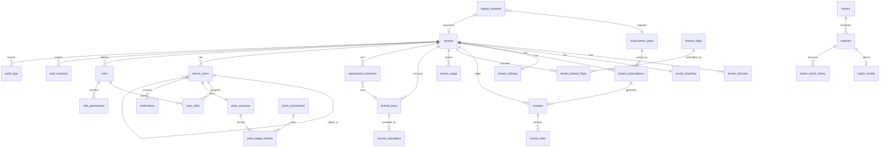

# Database

PostgreSQL 17. Schema managed by Alembic (`db/migrations`, run from `api/`).

## Conventions

- `uuid` primary keys (`gen_random_uuid()`), `timestamptz` in UTC (`created_at`, `updated_at`).
- Enums are `varchar` + `CHECK` (no native enum types to migrate).
- Soft deletion (`deleted_at`) for tenants, accounts, events, matches; their unique
  constraints are partial (`WHERE deleted_at IS NULL`).
- Money in integer cents (centavos) with a currency code. The platform currency is PHP (`DEFAULT_CURRENCY`, supported codes in `api/app/core/money.py`); fractional amounts (proration, tax) use `Decimal` with half-up rounding. Rows keep the currency they were created in — migration 0006 only changed the default for new plans; legacy USD rows are not relabelled. Points are `bigint` with no currency.
- Constraint names follow `uq_/ix_/ck_/fk_/pk_<table>_…` (naming convention in `shared/models.py`).

## Roles

Created once by `db/scripts/init-roles.sh`:

| Role | Used by | Notes |
|---|---|---|
| `esabong_owner` | Alembic | Owns the schema. Subject to RLS too (`FORCE`). |
| `esabong_app` | API tenant routes | **No BYPASSRLS.** No access to platform tables. |
| `esabong_platform` | Owner routes, workers | BYPASSRLS. |

## Relationships



## Tables

### Platform (no RLS)

| Table | Purpose | App role | Platform role |
|---|---|---|---|
| `platform_users` | owner staff (`super_admin/admin/billing/support`) | — | S I U |
| `subscription_plans` | SaaS and maintenance plans, limits (`max_users`, `max_events_per_month`), included modules | S | S I U D |
| `feature_flags` | flag catalogue with defaults | S | S I U D |
| `signup_requests` | prospective customers awaiting approval | — | S I U |
| `license_keys` | dedicated licenses (SHA-256 of the key, never the key) | — | S I U |
| `license_activations` | instance fingerprints per license | — | S I U |
| `deployment_instances` | dedicated installs and last heartbeat | — | S I U |

### Tenant-owned (RLS: `tenant_id = app_current_tenant()`)

| Table | Purpose | App role grants |
|---|---|---|
| `tenants` (RLS on `id`) | workspace, status, deployment mode | S |
| `tenant_domains` | subdomain + custom domains, DNS verification token | S I U D |
| `tenant_branding` | name, colours, logo/favicon/background URLs, login texts, contacts | S U |
| `tenant_settings` | timezone, locale, self-registration, enabled modules, grace days | S U |
| `tenant_feature_flags` | per-tenant overrides | S |
| `tenant_usage` | daily metrics (unique tenant+metric+day) | S |
| `tenant_subscriptions` | plan, cycle, status, periods, pending downgrade (one live per tenant) | S |
| `invoices`, `invoice_lines` | sequential numbers (`invoice_number_seq`), totals consistent by CHECK | S |
| `tenant_users` | accounts, type, parent (composite FK), status | S I U |
| `roles`, `role_permissions`, `user_roles` | RBAC | S I U D |
| `auth_sessions` | hashed refresh tokens, family, rotation chain (platform sessions have `tenant_id` NULL) | S I U D |
| `events`, `matches` | lifecycle, Meron/Wala competitor details | S I U |
| `match_results` | current official result + revision | S I U |
| `match_result_history` | every declaration/correction | **S I** (append-only) |
| `point_accounts` | one per user + one issuance account; `balance >= 0` for users | S I U |
| `point_transactions` | allocation/transfer/adjustment, unique idempotency key | **S I** |
| `point_ledger_entries` | ±amount per transaction with `balance_after` | **S I** |
| `notifications` | per-user inbox | S I U D |
| `audit_logs` | all changes; `tenant_id` NULL = platform action (invisible to tenants) | **S I** |

## Isolation mechanics

```sql
CREATE FUNCTION app_current_tenant() RETURNS uuid LANGUAGE sql STABLE
AS $$ SELECT NULLIF(current_setting('app.tenant_id', true), '')::uuid $$;

ALTER TABLE events ENABLE ROW LEVEL SECURITY;
ALTER TABLE events FORCE ROW LEVEL SECURITY;
CREATE POLICY tenant_isolation ON events
  USING (tenant_id = app_current_tenant())
  WITH CHECK (tenant_id = app_current_tenant());
```

The API sets `app.tenant_id` with `set_config(..., is_local => true)` at the start
of every transaction on the tenant engine. Composite foreign keys such as
`(tenant_id, parent_id) → tenant_users(tenant_id, id)` make cross-tenant
references impossible regardless of RLS (FK checks bypass RLS by design).

## Ledger invariants

- `sum(delta) = 0` per transaction (two entries: −amount, +amount).
- `−balance(issuance) = sum(balance(user accounts))` = points in circulation.
- `point_transactions.amount > 0`, `from_account_id <> to_account_id`.
- No foreign key or column links points to events, matches or results.

## Migrations

```bash
cd api
.venv/bin/alembic upgrade head                 # apply
.venv/bin/alembic downgrade -1                 # roll back one
.venv/bin/alembic revision --autogenerate -m "add x"   # new revision (review it!)
docker compose run --rm migrate                # in Docker
```

History: `0001` schema, `0002` RLS + grants, `0003` invoice number sequence.

**Adding a tenant-owned table** — in the same migration:

1. Include `tenant_id uuid NOT NULL REFERENCES tenants(id)` (use the `TenantScoped` mixin) and composite FKs for references to other tenant rows.
2. `enable_tenant_rls("<table>")` and `grant("<table>", app=..., platform=...)` from `app/core/migration_helpers.py`.
3. Add the table to `TENANT_TABLES` in `app/models.py`.

`tests/test_isolation.py::test_every_tenant_table_has_forced_rls_policy` fails if
any table with a `tenant_id` column lacks a forced policy.

Data migrations that touch tenant rows must run as `esabong_platform` or set
`app.tenant_id`, because `FORCE ROW LEVEL SECURITY` also applies to the owner.
