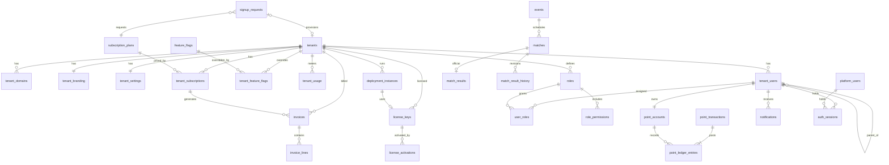

# Implementation Plan

White-label, multi-tenant event and match management platform, sold either as a
shared SaaS subscription or as a dedicated, licensed deployment.

This plan was written before implementation. Each milestone lists its
acceptance criteria.

## Status (2026-10-28)

All milestones implemented and verified; see [testing.md](testing.md).

| Milestone | Status | Evidence |
|---|---|---|
| M1 Foundation | Done | `docker compose up` brings up all services; migrations upgrade and downgrade cleanly |
| M2 Tenancy, auth, RBAC | Done | `test_auth.py`, `test_isolation.py`, `test_rbac.py` |
| M3 Owner portal: tenants | Done | `test_provisioning.py`; owner E2E |
| M4 Users and hierarchy | Done | `test_rbac.py` |
| M5 Events, matches, results | Done | `test_events.py`, `test_websocket.py`; live-result E2E |
| M6 Demonstration points | Done | `test_points.py` (incl. 50-way concurrency); points E2E |
| M7 Player portal | Done | E2E: live result, balance, branding |
| M8 Subscriptions and licensing | Done | `test_billing.py`, `test_licensing.py`, `test_dedicated_and_usage.py`; manual activation round trip |
| M9 Reports, usage, dashboards | Done | `test_events.py::test_reports_and_dashboard`, usage flush test |
| M10 Testing | Done | 89 backend, 26 frontend unit, 6 E2E |
| M11 Deployment and docs | Done | Images build; Caddy routing, on-demand TLS gate, CSP and WebSockets verified in a browser; backup → restore round trip verified |

---

## 1. Requirements analysis

### Business models

| Model | Tenancy | Billing | Provisioning |
|---|---|---|---|
| **SaaS subscription** | Shared database, row-level isolation | Monthly/annual plan, free trial, invoices | Owner approves a signup request → tenant auto-provisioned |
| **Dedicated license** | Separate deployment of the same codebase (`DEPLOYMENT_MODE=dedicated`) with exactly one tenant | License agreement + optional maintenance subscription | Owner issues a signed license, registers a deployment instance, the instance activates and heartbeats |

### Actors

| Actor | App | Scope |
|---|---|---|
| Platform owner staff (`super_admin`, `admin`, `billing`, `support`) | Owner portal | All tenants |
| Tenant admin | Admin portal | One tenant |
| Operator (event/match staff) | Admin portal | One tenant |
| Master agent | Admin portal (restricted) | Own downline |
| Agent | Admin portal (restricted) | Own downline |
| Player | Player portal | Self |

### Hard boundaries (product invariants)

The platform manages events, matches, official results, and a closed-loop
**demonstration points** ledger. The following are out of scope by design and
must not be added:

- No wagering: points cannot be staked on Meron, Wala, or any match outcome.
  The points ledger has **no foreign key to matches** and no endpoint accepts a
  match/side selection together with an amount.
- No settlement or payout tied to results.
- No redemption, cash-out, or conversion of points to money. Points carry no
  monetary value field and no currency.
- Point transfers flow **down** the account hierarchy only. Upward transfers
  (the mechanism used for off-platform cash-out) are rejected.
- No live video broadcasting.

Billing in this system is for **software subscriptions and licenses only**.

### Non-functional requirements

- Tenant isolation enforced in two independent layers: application (tenant-scoped
  repositories, token↔tenant binding) and database (PostgreSQL RLS with `FORCE`).
- UUID primary keys, UTC `timestamptz` everywhere, soft deletion for
  business entities, append-only audit and ledger tables (enforced by grants).
- Idempotent, race-safe point transfers.
- Branding and enabled modules loaded at runtime; one build serves every tenant.
- Same-origin deployment per tenant domain (no CORS in production), automatic
  HTTPS including tenant custom domains (Caddy on-demand TLS gated by the API).

---

## 2. Architecture

```
                     ┌─────────────────────────── Caddy (HTTPS, on-demand TLS) ──────────────────────────┐
 owner.<base>  ───►  │  /            → owner-web (static)                                                  │
                     │  /api, /api/ws → api                                                                │
 <slug>.<base> ───►  │  /            → player-web (static)                                                 │
 custom domain ───►  │  /admin/      → admin-web  (static)                                                 │
                     │  /api, /api/ws → api                                                                │
                     └─────────────────────────────────────────────────────────────────────────────────────┘
                                                       │
                                     ┌─────────────────▼──────────────────┐
                                     │ FastAPI (uvicorn workers)          │
                                     │  request-id + logging middleware   │
                                     │  tenant resolver (Host → tenant)   │
                                     │  JWT auth + RBAC dependencies      │
                                     │  modules: auth, tenants, users,    │
                                     │  agents, events, matches, results, │
                                     │  demo_points, subscriptions,       │
                                     │  licenses, reports, audit, ...     │
                                     └───────┬───────────────┬────────────┘
                     app role (RLS enforced) │               │ platform role (BYPASSRLS)
                                     ┌───────▼───────────────▼──┐      ┌──────────────┐
                                     │ PostgreSQL 16            │      │ Redis 7      │
                                     │  RLS on tenant tables    │      │ cache, pub/sub│
                                     └──────────────────────────┘      │ Celery broker │
                                                                       └──────┬───────┘
                                                              ┌───────────────▼───────────┐
                                                              │ Celery worker + beat      │
                                                              │ expiry, usage, domains,   │
                                                              │ notifications, licenses   │
                                                              └───────────────────────────┘
```

### Tenant resolution

1. `DEPLOYMENT_MODE=dedicated` → the single configured tenant.
2. `Host` header matches a **verified** row in `tenant_domains` → that tenant.
3. `Host` is `<slug>.<BASE_DOMAIN>` → tenant by slug.
4. Only when `ALLOW_TENANT_HEADER=true` (dev/test): `X-Tenant-Slug` header.

Results are cached in Redis for 60 s and invalidated when domains or tenant
status change. Suspended/cancelled tenants receive `403 tenant_suspended`
(the public branding endpoint still answers so the login page can render a
suspension notice).

### Isolation layers

| Layer | Mechanism |
|---|---|
| Token | Tenant access tokens carry `tid` and `aud=tenant`; a token is rejected unless `tid` equals the tenant resolved from the request host. Platform tokens carry `aud=platform` and are never accepted on tenant routes (and vice versa). |
| Application | Tenant-scoped repositories always filter by `tenant_id`; services never accept a tenant id from request bodies. |
| Database | The API's tenant engine connects as `esabong_app` (no `BYPASSRLS`). Each transaction runs `set_config('app.tenant_id', <id>, true)`. Every tenant table has `ENABLE` + `FORCE ROW LEVEL SECURITY` with `USING`/`WITH CHECK` on `tenant_id = NULLIF(current_setting('app.tenant_id', true), '')::uuid`. Missing context therefore returns zero rows (fail closed). |
| Privileges | `esabong_app` has no grants on platform-only tables (`platform_users`, `license_keys`, `deployment_instances`, `signup_requests`, …) and only `SELECT, INSERT` on append-only tables (`audit_logs`, `point_transactions`, `point_ledger_entries`, `match_result_history`). |

Platform-owner operations use a second engine as `esabong_platform`
(`BYPASSRLS`), only reachable through `aud=platform` routes and workers.

### Authentication

- Passwords: Argon2id.
- Access token: JWT (HS256, 15 min), held in memory by the SPA.
- Refresh token: opaque 256-bit random value, stored hashed in `auth_sessions`,
  delivered as `HttpOnly; Secure; SameSite=Strict; Path=/api/v1/…/auth` cookie,
  rotated on every refresh with reuse detection (a reused token revokes the
  whole session family).
- Login throttling per (tenant, username) and per IP in Redis.

### RBAC

Permissions are a fixed catalogue in code; roles are per-tenant rows mapping to
permission codes. System roles are seeded at provisioning and cannot be deleted.
Account *type* (admin / operator / master_agent / agent / player) determines the
position in the hierarchy; *roles* determine what an account can do.

| Permission | tenant_admin | operator | master_agent | agent | player |
|---|---|---|---|---|---|
| `dashboard.view` | ✓ | ✓ | ✓ | ✓ | |
| `users.view_all` / `users.manage` | ✓ | | | | |
| `users.view_downline` / `users.manage_downline` | ✓ | | ✓ | ✓ | |
| `roles.manage` | ✓ | | | | |
| `events.view` / `events.manage` | ✓ | ✓ | | | |
| `matches.manage` | ✓ | ✓ | | | |
| `results.declare` / `results.correct` | ✓ | ✓ / | | | |
| `points.allocate` / `points.adjust` / `points.view_all` | ✓ | | | | |
| `points.transfer` / `points.view_downline` | ✓ | | ✓ | ✓ | |
| `reports.view` | ✓ | ✓ | ✓ | ✓ | |
| `audit.view` / `settings.manage` / `branding.manage` / `billing.view` | ✓ | | | | |

Hierarchy rules: master agents sit at the top level; an agent's parent must be
a master agent; a player's parent may be an agent, a master agent, or none.

### Demonstration points ledger

Double-entry: every tenant has one `issuance` account whose balance may go
negative (total points in circulation = −issuance balance). User accounts have
`CHECK (balance >= 0)`.

Transfer algorithm (single transaction):

1. Validate the recipient is in the sender's downline (recursive CTE).
2. Insert `point_transactions` with `UNIQUE (tenant_id, idempotency_key)` and a
   SHA-256 of the canonical request. On conflict: same hash → return the
   original transaction (`200`, `Idempotent-Replay: true`); different hash →
   `409 idempotency_conflict`.
3. `SELECT … FOR UPDATE` both accounts **ordered by id** (deadlock-free).
4. Reject if balance is insufficient (`422 insufficient_points`).
5. Insert two `point_ledger_entries` (−amount, +amount) with `balance_after`.
6. Update balances; commit; publish a realtime event and notification.

### Realtime

`/api/ws?token=…` authenticates with the access token, then subscribes the
socket to Redis channel `tenant:{id}` (and `tenant:{id}:user:{uid}`). Services
publish `match.updated`, `match.result_declared`, `event.updated`,
`points.received`, `notification.created`. Redis fan-out makes this work across
multiple API replicas.

### Frontend

Angular 22 workspace (`web/`) with three applications and shared source
libraries under `web/shared/` consumed through TypeScript path aliases:

| Alias | Contents |
|---|---|
| `@shared/models` | DTO interfaces mirroring API schemas |
| `@shared/services` | `ApiClient`, auth store, branding/theme, toast, realtime, domain API clients |
| `@shared/guards` | `authGuard`, `guestGuard`, `permissionGuard` |
| `@shared/interceptors` | auth (bearer + silent refresh), tenant header (dev), error → toast |
| `@shared/components` | shell layout, data table, page header, stat card, skeleton, empty/error states, confirm dialog, status chip, chart, form-error, theme toggle |
| `@shared/directives`, `@shared/pipes` | `hasPermission` directive, relative time, points formatting |

State: Angular signals in services (`signal`, `computed`), RxJS for HTTP and
WebSocket streams, Reactive Forms with typed `FormGroup`s.

Theming: Angular Material M3 (`mat.theme`) + Tailwind v4. At bootstrap,
`BrandingService` fetches `/api/v1/public/tenant`, generates light and dark
tonal schemes from the tenant's primary/secondary colors with
`@material/material-color-utilities`, writes them to `--mat-sys-*` and
Tailwind `--color-brand-*` custom properties, and sets title and favicon. No
rebuild per tenant.

---

## 3. Database design

All tables: `id uuid PK default gen_random_uuid()`, `created_at`/`updated_at
timestamptz default now()`. Soft-deleted tables add `deleted_at`, and their
unique constraints are partial (`WHERE deleted_at IS NULL`).

### Relationships



### Tables

**Platform (no RLS, platform role only unless noted)**

| Table | Key columns | Constraints / indexes |
|---|---|---|
| `platform_users` | email, password_hash, full_name, role (`super_admin/admin/billing/support`), status, last_login_at | unique lower(email) |
| `subscription_plans` | code, name, kind (`saas/maintenance`), price_monthly_cents, price_annual_cents, currency, trial_days, limits jsonb, modules text[], is_active, sort_order | unique code; app role SELECT |
| `feature_flags` | key, description, default_enabled | unique key; app role SELECT |
| `signup_requests` | company_name, contact_name, contact_email, desired_slug, plan_id, billing_cycle, status (`pending/approved/rejected`), reviewed_by, tenant_id | index status |
| `license_keys` | tenant_id, key_prefix, key_hash, license_type (`perpetual/term`), status (`issued/active/expired/revoked`), max_activations, seats, expires_at, maintenance_until, issued_by | unique key_hash |
| `license_activations` | license_id, instance_fingerprint, hostname, activated_at, last_seen_at, deactivated_at | unique (license_id, instance_fingerprint) |
| `deployment_instances` | tenant_id, name, hostname, region, status (`provisioning/active/suspended/decommissioned`), license_id, app_version, last_heartbeat_at | unique hostname |

**Tenant (RLS on `tenant_id`, or `id` for `tenants`)**

| Table | Key columns | Constraints / indexes |
|---|---|---|
| `tenants` | slug, name, status (`pending/active/suspended/cancelled`), deployment_mode (`shared/dedicated`), suspended_reason, deleted_at | unique slug (partial) |
| `tenant_domains` | domain, is_primary, verification_status, verification_token, verified_at | unique lower(domain); one primary per tenant (partial unique) |
| `tenant_branding` | tenant_id PK, app_name, logo_url, favicon_url, primary/secondary/background/surface colors, login_title, login_subtitle, login_background_url, contact_email, contact_phone, contact_address | color CHECK `^#[0-9a-fA-F]{6}$` |
| `tenant_settings` | tenant_id PK, timezone, locale, allow_self_registration, enabled_modules text[], suspension_grace_days | |
| `tenant_subscriptions` | plan_id, billing_cycle, status (`trialing/active/past_due/expired/cancelled`), trial_ends_at, current_period_start/end, cancel_at_period_end, pending_plan_id | partial unique (tenant_id) where status in live states |
| `invoices` | subscription_id, number, status (`draft/open/paid/void`), currency, subtotal/tax/total cents, period_start/end, issued_at, due_at, paid_at, payment_reference | unique number |
| `invoice_lines` | invoice_id, description, quantity, unit_amount_cents, amount_cents, kind (`plan/proration/credit`) | |
| `tenant_feature_flags` | flag_id, enabled | unique (tenant_id, flag_id) |
| `tenant_usage` | metric, period_date, value | unique (tenant_id, metric, period_date) |
| `tenant_users` | username, email, password_hash, full_name, phone, account_type, parent_id → tenant_users, status (`active/suspended`), last_login_at, deleted_at | unique (tenant_id, lower(username)) and (tenant_id, lower(email)) partial; index (tenant_id, parent_id) |
| `roles` | name, description, is_system | unique (tenant_id, name) |
| `role_permissions` | role_id, permission | PK (role_id, permission) |
| `user_roles` | user_id, role_id | PK (user_id, role_id) |
| `auth_sessions` | subject_type, subject_id, family_id, token_hash, expires_at, revoked_at, replaced_by_id, ip, user_agent | unique token_hash; tenant_id nullable (platform sessions) |
| `events` | name, venue, description, starts_at, ends_at, status (`draft/scheduled/live/completed/cancelled`), created_by, deleted_at | index (tenant_id, status, starts_at) |
| `matches` | event_id, match_number, meron_name, meron_details, wala_name, wala_details, scheduled_at, started_at, ended_at, status (`scheduled/in_progress/completed/cancelled`), deleted_at | unique (event_id, match_number) partial |
| `match_results` | match_id, outcome (`meron/wala/draw/no_contest`), declared_by, declared_at, notes, revision | unique match_id |
| `match_result_history` | match_id, outcome, previous_outcome, reason, revision, changed_by | append-only |
| `point_accounts` | user_id nullable, kind (`issuance/user`), balance bigint | unique (tenant_id, user_id); one issuance per tenant; CHECK kind='issuance' OR balance>=0 |
| `point_transactions` | kind (`allocation/transfer/adjustment`), idempotency_key, request_hash, from_account_id, to_account_id, amount > 0, memo, created_by | unique (tenant_id, idempotency_key); append-only |
| `point_ledger_entries` | transaction_id, account_id, delta, balance_after | index (account_id, created_at); append-only |
| `notifications` | user_id, type, title, body, data jsonb, read_at | index (tenant_id, user_id, read_at) |
| `audit_logs` | tenant_id nullable, actor_type, actor_id, action, resource_type, resource_id, changes jsonb, ip, user_agent, request_id | index (tenant_id, created_at); append-only |

---

## 4. API contracts (v1)

Base path `/api/v1`. JSON bodies; errors use one envelope:

```json
{ "error": { "code": "insufficient_points", "message": "…", "details": {}, "request_id": "…" } }
```

Lists use `?page=1&page_size=25&q=&sort=` and return
`{ "items": [], "total": 0, "page": 1, "page_size": 25 }`.

Mutating point endpoints require an `Idempotency-Key` header (8–128 chars).

### Public

| Method | Path | Notes |
|---|---|---|
| GET | `/health`, `/ready` | liveness / DB+Redis readiness (outside `/v1`) |
| GET | `/public/tenant` | branding, modules, registration flag, status for the resolved tenant |
| GET | `/public/plans` | active SaaS plans |
| POST | `/public/signup-requests` | prospective customer requests a subscription |

### Platform owner (`aud=platform`)

| Method | Path | Permission |
|---|---|---|
| POST | `/platform/auth/login`, `/refresh`, `/logout`; GET `/platform/auth/me` | — |
| GET/POST | `/platform/tenants` | admin+ to create |
| GET/PATCH/DELETE | `/platform/tenants/{id}` | |
| POST | `/platform/tenants/{id}/suspend`, `/activate` | admin+ |
| GET/POST | `/platform/tenants/{id}/domains`; POST `/platform/domains/{id}/verify`; DELETE `/platform/domains/{id}` | admin+ |
| GET/PUT | `/platform/tenants/{id}/branding` | admin+ |
| GET/PUT | `/platform/tenants/{id}/feature-flags` | admin+ |
| GET | `/platform/tenants/{id}/usage` | |
| GET | `/platform/signup-requests`; POST `/{id}/approve`, `/{id}/reject` | admin+ |
| GET/POST/PATCH | `/platform/plans` | admin+ |
| GET | `/platform/subscriptions`; POST `/platform/tenants/{id}/subscription`; POST `/platform/subscriptions/{id}/change-plan`, `/cancel`, `/renew` | billing+ |
| GET | `/platform/invoices`, `/platform/invoices/{id}`; POST `/{id}/mark-paid`, `/{id}/void` | billing+ |
| GET/POST | `/platform/licenses`; POST `/platform/licenses/{id}/revoke` | admin+ |
| GET/POST/PATCH | `/platform/deployments` | admin+ |
| GET/POST/PATCH | `/platform/feature-flags` | admin+ |
| GET | `/platform/analytics/overview` | |
| GET | `/platform/audit-logs` | |
| POST | `/licensing/activate`, `/licensing/heartbeat` | license key (dedicated instances) |

### Tenant auth (`aud=tenant`, host-resolved tenant)

| Method | Path |
|---|---|
| POST | `/auth/login`, `/auth/register` (when enabled), `/auth/refresh`, `/auth/logout` |
| GET/PATCH | `/auth/me`; POST `/auth/me/password` |

### Tenant administration

| Method | Path | Permission |
|---|---|---|
| GET | `/admin/dashboard` | dashboard.view |
| GET/POST | `/admin/users`; GET/PATCH/DELETE `/admin/users/{id}`; POST `/{id}/suspend`, `/{id}/activate`, `/{id}/reset-password` | users.* (downline-scoped for agents) |
| GET | `/admin/hierarchy?root_id=` | users.view_* |
| GET | `/admin/permissions`; GET/POST/PATCH/DELETE `/admin/roles` | roles.manage |
| GET/POST/PATCH/DELETE | `/admin/events`; POST `/admin/events/{id}/{publish,start,complete,cancel}` | events.manage |
| GET/POST | `/admin/events/{id}/matches`; GET/PATCH/DELETE `/admin/matches/{id}`; POST `/admin/matches/{id}/{start,cancel}` | matches.manage |
| POST | `/admin/matches/{id}/result` | results.declare |
| PUT | `/admin/matches/{id}/result` (reason required) | results.correct |
| GET | `/admin/matches/{id}/result/history` | events.view |
| POST | `/admin/points/allocations` | points.allocate |
| POST | `/admin/points/transfers` | points.transfer |
| POST | `/admin/points/adjustments` | points.adjust |
| GET | `/admin/points/transactions`, `/admin/points/accounts/{user_id}`, `/admin/points/summary` | points.view_* |
| GET | `/admin/reports/activity`, `/points`, `/matches` (+ `?format=csv`) | reports.view |
| GET | `/admin/audit-logs` | audit.view |
| GET/PUT | `/admin/settings` | settings.manage |
| GET/PUT | `/admin/branding`; POST `/admin/branding/assets/{logo,favicon,login_background}` | branding.manage |
| GET | `/admin/subscription`, `/admin/invoices` | billing.view |

### End-user portal

| Method | Path |
|---|---|
| GET | `/portal/dashboard` |
| GET | `/portal/events`, `/portal/events/{id}`, `/portal/events/{id}/matches`, `/portal/matches/{id}` |
| GET | `/portal/results` |
| GET | `/portal/points`, `/portal/points/history` |
| GET | `/portal/activity` |
| GET | `/portal/notifications`; POST `/portal/notifications/{id}/read`, `/portal/notifications/read-all` |
| WS | `/api/ws?token=` |

---

## 5. Milestones and acceptance criteria

MVP = milestones 1–8. 9–11 harden and extend.

### M1 — Foundation
- Monorepo layout `api/ web/ db/ infrastructure/ docs/`; `docker compose up` brings up Postgres, Redis, API, worker, beat, Caddy, Mailpit.
- **Accept:** `GET /api/health` 200; `/api/ready` reports DB + Redis; `alembic upgrade head` from empty DB succeeds and `downgrade base` round-trips.

### M2 — Tenancy, auth, RBAC
- DB roles, RLS policies, tenant resolver, platform + tenant auth, refresh rotation, RBAC dependencies, audit logging.
- **Accept:** a query through the tenant engine without tenant context returns 0 rows; tenant A token on tenant B host → 401; tenant A admin cannot read/modify tenant B users, events, points by id (404); refresh-token reuse revokes the family; locked out after N failed logins.

### M3 — Owner portal: tenants
- Signup request → approve → provisioning (tenant, primary subdomain, branding, settings, system roles, issuance account, trial subscription, tenant admin with temporary password + email). Suspend/activate, domains with DNS TXT verification, branding, feature flags, audit log.
- **Accept:** approved request yields a usable tenant whose admin can log in on `<slug>.<base>`; suspended tenant gets `403 tenant_suspended`; Caddy `ask` endpoint returns 200 only for verified domains.

### M4 — Tenant admin: users and hierarchy
- Users CRUD by type, hierarchy rules, downline scoping, roles & permissions, plan user limits.
- **Accept:** agent cannot see or edit accounts outside their downline; invalid parent types rejected; custom role with subset permissions restricts endpoints; user limit enforced with `402 plan_limit_reached`.

### M5 — Events, matches, results
- Event and match lifecycle, Meron/Wala details, result declaration and audited correction, realtime broadcast.
- **Accept:** state machine rejects illegal transitions (e.g. result on a cancelled match); correction requires reason and appends history; WS client in tenant A receives A's result and not B's.

### M6 — Demonstration points
- Issuance, allocation, downline transfers, adjustments, history, idempotency.
- **Accept:** 50 concurrent transfers from one account never overdraw and the ledger sums to zero per transaction; same idempotency key replayed returns the same transaction; same key with different body → 409; upward transfer rejected.

### M7 — Player portal
- Login/registration, dashboard, events, match info, results, history, points, activity, notifications, profile, live updates.
- **Accept:** player only sees published events of their tenant; branding (name, colors, logo, favicon) changes appear on reload without rebuilding.

### M8 — Subscriptions and licensing
- Plans, trials, monthly/annual, upgrades (prorated, immediate) and downgrades (at period end), invoices, manual payment recording, expiry → past_due → suspension, license issue/activate/heartbeat/expire/revoke, dedicated-mode license enforcement.
- **Accept:** beat task suspends a tenant after expiry + grace; upgrade produces a proration invoice; license token verifies offline with the public key and fails after tampering; revoked license fails heartbeat.

### M9 — Reports, usage analytics, dashboards
- **Accept:** usage metrics recorded per tenant per day; owner overview shows tenants by status, MRR, trials ending; CSV exports.

### M10 — Testing
- Pytest suites (unit, integration, auth, RBAC, isolation, concurrency, WebSocket) against real Postgres/Redis; Angular unit tests (Vitest); Playwright E2E across the three portals.

### M11 — Deployment and documentation
- Dockerfiles, compose (dev + prod), Caddy with HTTPS and on-demand TLS, `.env.example`, backup/restore scripts, deployment runbook, architecture/database/API docs.

---

## 6. Explicitly deferred (not presented as done)

- **Payment processing.** Invoices are generated, numbered and tracked; payment is
  recorded manually (`mark-paid` with a reference). No card/gateway integration.
- **Infrastructure automation for dedicated installs.** The platform tracks
  instances, licenses and heartbeats; servers are provisioned by following
  [deployment.md §8](deployment.md#8-dedicated-licensed-installations).
- **Object storage.** Brand assets live on a Docker volume behind
  `core/storage.py`; S3-compatible storage is not implemented.
- **Multi-factor authentication** for platform staff and tenant admins.
- **Localisation.** `tenant_settings.locale` is stored, but the UI ships in English only.
- **Global API rate limiting.** Login lockout plus per-IP limits on signup and
  licensing endpoints exist; a general per-tenant request quota does not.
- **Email templates** are plain text.
