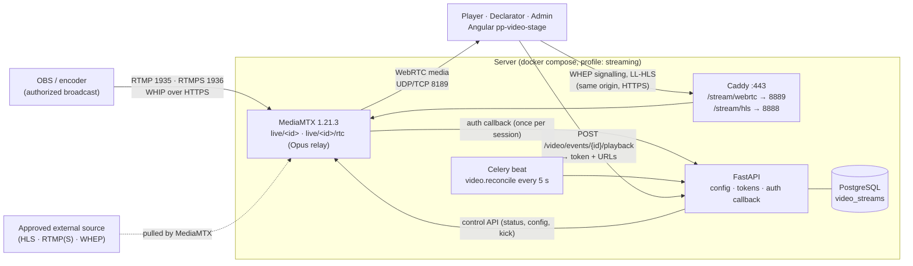

# Live streaming (MediaMTX · WebRTC · LL-HLS)

Low-latency live video for the arena display, the Declarator desk and the administrator
preview. An authorized broadcast (OBS, or an approved external source) reaches **MediaMTX**,
which serves it to browsers over **WebRTC (WHEP)** and falls back to **Low-Latency HLS**. Media
never passes through FastAPI: the API stores configuration, answers one authorization callback
per session, mints short-lived playback tokens and reconciles status every few seconds.

> Latency figures below are measurements on one development machine (loopback network), not
> guarantees. Real latency depends on the broadcaster's encoder settings, the uplink and each
> viewer's network. Measure again on the target deployment.

- [Architecture](#architecture)
- [Security model](#security-model)
- [Set-up (Docker, MediaMTX, Caddy)](#set-up)
- [Broadcasting with OBS](#broadcasting-with-obs)
- [External and test sources](#external-and-test-sources)
- [Administration, Declarator and Player](#administration-declarator-and-player)
- [Angular player](#angular-player)
- [FastAPI integration](#fastapi-integration)
- [Oracle Cloud deployment, network and firewall](#oracle-cloud-deployment-network-and-firewall)
- [WebRTC, STUN and TURN](#webrtc-stun-and-turn)
- [Bandwidth and server sizing](#bandwidth-and-server-sizing)
- [Troubleshooting and performance](#troubleshooting-and-performance)
- [Test results](#test-results)
- [Limitations](#limitations)

## Architecture



| Path in MediaMTX | Carries | Read by |
|---|---|---|
| `live/<id>` | the stream as published (OBS/WHIP) or pulled (external/test) | HLS, and WebRTC when the codecs are WebRTC-ready (H.264/VP8/VP9/AV1 + Opus) |
| `live/<id>/rtc` | in-container relay: video copied, audio converted to Opus | WebRTC when the source has AAC audio (OBS's default) |

`<id>` is 24 random URL-safe characters. It is not a secret on its own: publishing needs the
publish key and reading needs a playback token.

A stream is assigned to one **arena (event)** or set as the tenant's **default** stream for
every event without its own. The existing `POST /video/events/{event_id}/playback` returns it;
when no stream applies, the external video provider behaves exactly as before.

## Security model

- **Publish keys**: 192-bit random, shown once (creation or rotation), stored only as SHA-256.
  Rotation disconnects the current broadcaster. Failed publish attempts are rate-limited per IP
  (20 per 10 min).
- **Playback tokens**: HMAC-SHA256 (key derived from `JWT_SECRET`), 5 minutes, bound to tenant,
  stream, path, user, login-session family and audience (`player`, `declarator`, `admin`).
  The token only authorizes *starting* a session; MediaMTX asks the API once per session (HLS
  uses a session cookie for the following segment requests).
- **Authorization callback** (`POST /api/v1/internal/mediamtx/auth`): no secret in the URL.
  Caddy answers 404 for `/api/v1/internal/*`; the route also refuses any request carrying proxy
  forwarding headers, so it is reachable only container-to-container. It answers only allow
  (200) / deny (401). RTSP (relay and test pattern) is accepted only from loopback inside the
  MediaMTX container; public reads only over WebRTC/HLS; nobody publishes to `/rtc`.
- **MediaMTX control API** (`:9997`, never published): HTTP Basic with
  `MEDIAMTX_API_USER`/`MEDIAMTX_API_PASSWORD` (24+ chars in production), checked by the callback,
  failures rate-limited.
- **Access that ends after a session started**: every 5 s the reconciliation task disconnects
  viewers of streams that were disabled for players or deleted, and viewers whose login session
  was revoked (sign-out, password change, suspension). Disabling also disconnects player
  sessions immediately; administrator previews and declarator monitors continue.
- **External sources**: only `https://…m3u8`, `rtmp(s)://` and `wheps://` on hosts listed in
  `VIDEO_SOURCE_HOSTS`, which must resolve to public addresses (no SSRF into the server network).
  The URL may embed provider credentials; it is Fernet-encrypted with `VIDEO_CREDENTIALS_KEY`,
  never returned, logged or audited, and sent only to MediaMTX. Do not bypass DRM, provider
  authentication or access restrictions; only relay sources you are authorized to redistribute.
- **Tenancy**: `video_streams` has forced row-level security; every admin route is scoped to the
  tenant; a token for one stream cannot open another.
- **Tokens in URLs**: the playback token travels as `?token=` (native HLS cannot send headers).
  Caddy removes `token` from access logs; tokens expire after 5 minutes.
- **Audit**: create, update (assignment, visibility, source replaced; never the URL), delete,
  key rotation and reconnect are written to the audit log.

## Set-up

Streaming is opt-in. Without it nothing changes: no new ports, the stage keeps using the
external provider.

1. `.env` (see `.env.example`):

   ```bash
   COMPOSE_PROFILES=streaming            # add to existing profiles, e.g. dev,streaming
   MEDIAMTX_API_PASSWORD=<24+ random characters>
   STREAM_PUBLIC_HOSTS=203.0.113.10      # the server's public IP or DNS name (WebRTC candidates)
   STREAM_RTMP_URL=rtmp://stream.example.com:1935
   VIDEO_CREDENTIALS_KEY=<Fernet key>    # only for external sources with credentials
   ```
2. `docker compose up -d` (production: `-f docker-compose.yml -f docker-compose.prod.yml`).
   Apply migration **0016** (`alembic upgrade head`) through the normal release process.
3. Caddy needs no change on the host: `/stream/webrtc/*` and `/stream/hls/*` are already routed
   on tenant hosts (`infrastructure/caddy/Caddyfile`, snippet `(stream)`).
4. Open the ports in [Oracle Cloud](#oracle-cloud-deployment-network-and-firewall).
5. `python3 infrastructure/scripts/preflight.py` (Python 3.10+) checks that only RTMP/RTMPS and
   WebRTC media are public and that `STREAM_PUBLIC_HOSTS` is set.

**MediaMTX configuration** (`infrastructure/mediamtx/mediamtx.yml`, mounted read-only):
HTTP authentication through the API; control API and metrics internal; RTSP on loopback only;
RTMP 1935 (RTMPS 1936 when `STREAM_RTMP_ENCRYPTION=optional|strict` and a certificate is mounted);
LL-HLS (200 ms parts, 1 s segments, always remuxed for a fast fallback start); WebRTC on
UDP+TCP 8189 advertising `STREAM_PUBLIC_HOSTS`; SRT, MoQ, playback and pprof off. Runtime path
configuration for external and test streams is pushed by the API; the database is the source
of truth, so a restarted MediaMTX is reconfigured within one reconciliation pass (5 s).

**Resources** (production overlay): 2 CPUs and 2 GiB by default (about 1 GiB + 4 MiB per peak
viewer; raise it for large audiences) (`MEDIAMTX_CPUS`,
`MEDIAMTX_MEMORY`), JSON log rotation like every other service, a listener healthcheck.

**Local development**: start MediaMTX with the `streaming` profile; `web/proxy.conf.json` maps
`/stream/webrtc`, `/stream/hls` (and the HLS cookie-check redirect `/live`) to its loopback
ports 8889/8888, so `ng serve` works without Caddy.

## Broadcasting with OBS

In **Admin → Live streaming**, add a stream with source *OBS / encoder*. The publish key is shown
once.

| OBS (Settings › Stream) | Value |
|---|---|
| Service | Custom… |
| Server | `rtmp://<host>:1935/live` (or `rtmps://<host>:1936/live` when enabled) |
| Stream key | `<id>?key=<publish key>` (shown after creation) |

OBS 30+ can also publish with **WHIP** (Service: WHIP), encrypted through Caddy:
Server `https://<tenant host>/stream/webrtc/live/<id>/whip`, Bearer token `<publish key>`.
WHIP removes one remux step and needs no extra port.

Recommended encoder settings for low latency:

| Setting | Value |
|---|---|
| Output | 1280×720 at 30 fps (1920×1080 needs ~2× the bandwidth) |
| Rate control | CBR, 2,500–3,500 kbps video |
| Keyframe interval | **1 s** (LL-HLS segments and WebRTC joins align to keyframes) |
| Encoder | x264 `veryfast`, tune `zerolatency`, profile baseline/main, no B-frames; or NVENC/QuickSync low-latency preset |
| Audio | AAC 128 kbps (converted to Opus for WebRTC by the relay) or Opus |

OBS reconnects automatically when the connection drops (Settings › Advanced › Automatically
reconnect). *Reconnect* in the admin page drops the current OBS connection on purpose; OBS then
reconnects by itself.

## External and test sources

- **External** (`Authorized external source`): `https://…/index.m3u8`, `rtmp(s)://…`, or
  `wheps://…/whep` on a host approved by the operator in `VIDEO_SOURCE_HOSTS`. Enabled streams
  are pulled continuously (status reflects availability, viewers start instantly); disabled
  ones are pulled only while previewed. *Reconnect* forces a fresh pull. Compatibility is shown
  on the stream card (codecs, “WebRTC ready” / “HLS only for now”); H.264 or VP8/VP9/AV1 video
  plays everywhere, HEVC does not play in most browsers over WebRTC.
- **Test pattern** (development only, refused in production): a moving 720p30 picture with a
  tone, generated by ffmpeg inside MediaMTX. The whole integration can be tested without any
  real event, camera or video subscription.

## Administration, Declarator and Player

- **Admin → Live streaming** (`settings.manage`, events module): add a stream; choose source,
  name, arena (event) or *Default for every event*; see status (Offline · Connecting · Live ·
  Reconnecting · Error), viewers, codecs and last live time; *Test playback* before enabling;
  *Visible to players*; *Reconnect*; *New publish key*; *Delete*. Server health: reachability,
  live streams, WebRTC/HLS viewers, outbound bandwidth. The page refreshes every 5 s and on push.
- **Declarator desk**: the assigned event's stream loads automatically in the existing monitor,
  also before it is opened to players. *Reconnect* re-pulls an external/test source that is not
  live (throttled); OBS sources reconnect on their own.
- **Player arena**: the existing video area plays the event's stream once it is enabled. Order
  on the page is unchanged: video, fight number, Meron/Wala/Draw, amount and balance, records.

## Angular player

`pp-video-stage` (`web/shared/arena/video-stage.ts`) with `WhepSession` (`whep-client.ts`):

- WebRTC first: one `POST` with the SDP offer (no waiting for ICE gathering), `recvonly` audio
  and video, ICE servers from the API. The server session is deleted when the viewer leaves.
- **HLS fallback**: when the browser has no WebRTC, or WebRTC shows no picture within 8 s (UDP
  blocked), hls.js in low-latency mode (native HLS only where MSE is unavailable). The choice
  sticks for the visit.
- **Reconnect** with exponential backoff (1 s doubling to 30 s, ±20 % jitter), reset after 15 s of
  stable playback. The server's `video.stream_status` push (every ~5 s from the reconciliation
  task) acts in both directions: `live` reconnects at once; `offline`/`reconnecting` drops a
  session the browser has not yet noticed is dead. A frame watchdog also treats 3 s without a
  presented frame (while not paused) as a dead session. Measured with the real player: picture
  back ~5.4 s after the broadcaster returns, ~5.6–6.7 s after a MediaMTX restart, one reconnect
  attempt each ([evidence](../readiness/2026-11-03-contabo/)).
  Offline streams show *Stream offline — waiting for the broadcast* and recover by themselves.
- **No restarts on unrelated updates**: a live stream is identified by its stream id, not its
  tokenized URL, so odds, fight numbers, results, balance, wagers, WebSocket frames and token
  refreshes never reconnect it (verified end to end: one WebRTC session through result and
  fight updates).
- Loading spinner, LIVE badge, *Live · WebRTC* / *Live · HLS* source label, mute, volume
  (remembered per device; hidden on phones, which use hardware keys), fullscreen, offline and
  autoplay-blocked states.

## FastAPI integration

| Endpoint | Who | Purpose |
|---|---|---|
| `GET /api/v1/admin/streams` | `settings.manage` | list with live status, viewers, codecs, ingest details (never the key) |
| `POST /api/v1/admin/streams` | `settings.manage` | create; returns the publish key once |
| `PATCH /api/v1/admin/streams/{id}` | `settings.manage` | name, source URL (write-only), arena/default, visible to players |
| `DELETE /api/v1/admin/streams/{id}` | `settings.manage` | delete and disconnect everyone |
| `POST …/{id}/rotate-key` | `settings.manage` | new key once; drops the broadcaster |
| `POST …/{id}/reconnect` | `settings.manage` | re-pull / drop OBS connection (throttled) |
| `POST …/{id}/preview` | `settings.manage` | admin playback, also while hidden from players |
| `GET /api/v1/admin/streams/health` | `settings.manage` | server reachability, viewers, outbound kbps |
| `POST /api/v1/video/events/{event_id}/playback` | players, assigned declarators | existing endpoint: `webrtc` playback + HLS `fallback_url`, or a status |
| `POST /api/v1/internal/mediamtx/auth` | MediaMTX only | allow/deny one session |

Code: `api/app/modules/video/` (`streams.py`, `stream_router.py`, `mediamtx.py`,
`stream_schemas.py`, model `VideoStream`), migration `20261103_0016_video_streams.py`, Celery task
`video.reconcile`. Wallets, wagers, settlement and results are untouched.

## Oracle Cloud deployment, network and firewall

| Port | Protocol | Open to | Purpose |
|---|---|---|---|
| 443 | TCP | Internet | portals, API, WHEP/WHIP signalling, LL-HLS (Caddy) |
| 80 | TCP | Internet | ACME and redirect |
| 8189 | **UDP** | Internet | WebRTC media (primary) |
| 8189 | TCP | Internet | WebRTC media where UDP is blocked |
| 1935 | TCP | broadcaster IPs if possible | RTMP ingest |
| 1936 | TCP | broadcaster IPs if possible | RTMPS ingest (when enabled) |

Add these to the VCN security list or NSG **and** the instance firewall
(`firewall-cmd --add-port=8189/udp --add-port=8189/tcp --add-port=1935/tcp --permanent`).
Never open 8888, 8889, 9997 or 9998. Set `STREAM_PUBLIC_HOSTS` to the instance's public IP or a DNS
name that resolves to it (Oracle instances only know their private address).

**Keeping media private (Contabo layout).** `STREAM_WEBRTC_BIND` (default `0.0.0.0`) sets the host
address the WebRTC media port is published on; `STREAM_RTMP_BIND` / `STREAM_RTMPS_BIND` do the same for
ingest. With all three at `127.0.0.1` nothing of MediaMTX is reachable from the internet: players fall
back to LL-HLS through Caddy on 443, and broadcasters publish with WHIP over HTTPS (Bearer publish key).
The production template ships that way; set `STREAM_WEBRTC_BIND=0.0.0.0` only once public streaming
is authorized and the host firewall allows TCP+UDP on `STREAM_WEBRTC_PORT`.

**Do not plan 1,000 viewers on one Always Free VM.** WebRTC and HLS are unicast: every viewer is a
separate copy of the stream (see the next section). Ampere A1 bandwidth grows with OCPUs, E2.1.Micro
offers well under 1 Gbps; check the current shape limits and egress pricing before an event.

## WebRTC, STUN and TURN

- MediaMTX runs with a public address (`STREAM_PUBLIC_HOSTS`), so most viewers need **no STUN or
  TURN**: the browser connects to the server's candidate, the server learns the browser's
  address from the connectivity check.
- ICE over **TCP 8189** covers many networks that block UDP. Where neither works (strict
  corporate proxies), the player falls back to LL-HLS on 443.
- **TURN** (coturn) is optional: set `STREAM_TURN_URLS` (e.g. `["turns:turn.example.com:5349"]`) and
  `STREAM_TURN_SECRET` (coturn `use-auth-secret`, `static-auth-secret`). The API issues
  time-limited TURN credentials (1 h, TURN REST API) per playback; no TURN password reaches
  players. TURN relays all media, so budget its bandwidth like the media server's.
- `STREAM_STUN_URLS` adds STUN servers for browsers if needed.

## Bandwidth and server sizing

Each viewer receives its own copy. With 720p30 at ~2.5 Mbps video + audio, plan **~2.8 Mbps per
viewer** including packet overhead (measured below: a 2.1 Mbps stream cost the server 2.3 Mbps
per viewer at 10–50 viewers; retransmissions add more on lossy networks).

| Viewers | Egress (720p, ~2.8 Mbps each) | Data per hour | Data per 3-hour event |
|---:|---:|---:|---:|
| 10 | 28 Mbps | 12.6 GB | 38 GB |
| 50 | 140 Mbps | 63 GB | 189 GB |
| 100 | 280 Mbps | 126 GB | 378 GB |
| 500 | 1.4 Gbps | 630 GB | 1.9 TB |
| 1,000 | 2.8 Gbps | 1.26 TB | 3.8 TB |

MediaMTX relays without transcoding (only the Opus audio relay transcodes, ~1 % CPU per stream),
so **bandwidth, not CPU, is the limit**; memory grows ~3–5 MiB per WebRTC viewer (see the
measurements). Beyond a few hundred viewers per server: put a CDN in
front of LL-HLS (MediaMTX `hlsCDNSecret`; adds 1–3 s latency) and keep WebRTC for those who need
the lowest latency, or run several MediaMTX edge servers pulling from one origin. Lower bitrate
(e.g. 1.5 Mbps 720p, or a 480p rendition) halves the bill.

## Troubleshooting and performance

| Symptom | Check |
|---|---|
| Admin page says *Not configured* | `MEDIAMTX_API_PASSWORD` on the API; `COMPOSE_PROFILES` includes `streaming` |
| *Streaming server unreachable* | `docker compose ps mediamtx`; API can reach `http://mediamtx:9997`; same password on both sides |
| OBS: *Failed to connect* / *Operation not permitted* | stream key is `<id>?key=<publish key>`; key not rotated; port 1935 open; not rate-limited after failed attempts (10 min) |
| Players see *Live · HLS* everywhere | UDP/TCP 8189 not open, or `STREAM_PUBLIC_HOSTS` wrong (WebRTC never connects, the player falls back) |
| Picture but no sound over WebRTC | AAC source before the relay is up (“HLS only for now” on the card); it switches on the next reconnect |
| HLS latency high | keyframe interval > 1 s in the encoder; LL-HLS needs regular keyframes |
| `part duration changed … iOS` in MediaMTX logs | variable frame timing; iOS before 17.1 (no MSE) may stall on native LL-HLS. Use a constant 30 fps output |
| External source *error* | host in `VIDEO_SOURCE_HOSTS`, resolves to a public IP, URL reachable from the server, H.264 video |

MediaMTX logs one line per session (`docker compose logs mediamtx`); the API logs each auth
decision as `mediamtx_auth` with the reason (never the token or key).

## Test results

Measured on 3 November 2026: one Apple M5 laptop (10 cores, 24 GB), Docker Desktop (10 CPUs,
12 GB), MediaMTX 1.21.3-ffmpeg with this repository's configuration, the API, and headless
Chromium 156 viewers, all on the same machine (loopback network). Raw data:
[`results/`](results/); harnesses: `scripts/benchmarks/streaming/` (`latency.mjs`, `load.mjs`).

### Glass-to-glass latency

The publisher page paints the current time into every frame (44 black/white blocks); each viewer
decodes the blocks from every displayed frame. Same browser, same clock, so latency is a direct
subtraction (20–25 s per row, every displayed frame sampled). Excludes camera exposure and monitor
scan-out, which are outside this system.

| Ingest → playback | Frames | Start-up | p50 | p95 | Max | Loss |
|---|---:|---:|---:|---:|---:|---:|
| WHIP → WebRTC | 568 | 980 ms | **42 ms** | **59 ms** | 60 ms | 0 |
| WHIP → WebRTC via the Opus relay (`/rtc`) | 505 | 885 ms | **58 ms** | **91 ms** | 108 ms | 0 |
| WHIP → LL-HLS (hls.js) | 745 | 68 ms | 2,041 ms | 2,057 ms | 2,134 ms | — |
| OBS-like: x264 `veryfast`/zerolatency re-encode + RTMP → WebRTC | 573 | 795 ms | **401 ms** | **418 ms** | 436 ms | 0 |
| OBS-like → LL-HLS | 749 | 55 ms | 1,404 ms | 1,421 ms | 1,437 ms | — |

- WebRTC delivery is sub-100 ms at p95 here; the encoder hop dominates the OBS figure. The OBS
  stand-in decodes the first stream again before re-encoding, so it overstates a camera → OBS
  chain; a second run with ffmpeg's low-delay input flags was *worse* (p50 533 ms, p95 999 ms),
  so this hop is sensitive to encoder settings. **Measure with the real OBS, camera and uplink.**
- LL-HLS depends on keyframe spacing: with x264's fixed 1 s keyframes it is 1.4 s, with the
  browser encoder's longer keyframe interval 2.0 s. Keep OBS keyframes at 1 s.
- WebRTC start-up (request to first frame) was 0.8–1.0 s here, mostly waiting for the next
  keyframe; earlier single-session checks measured 186–851 ms. With 1 s keyframes, expect ≤ ~1 s.

### Concurrent viewers

Viewers are WebRTC sessions in headless Chromium (100 per browser context), each negotiating WHEP
through the API's auth callback and receiving and decoding the stream. 30 s hold per level.
Source: OBS-like RTMP feed (H.264 + AAC, read through the Opus relay).

| Stream | Viewers | Joined | Join time | First packet p50 / p95 | Loss | Jitter p50 / p95 | Received per viewer | MediaMTX sent | MediaMTX CPU | MediaMTX memory | Laptop CPU |
|---|---:|---:|---:|---:|---:|---:|---:|---:|---:|---:|---:|
| 720p 2.1 Mbps | 10 | 10 | 0.4 s | 137 / 318 ms | 0 % | 8 / 9 ms | 2.00 Mbps | 23 Mbps | 15 % | 121 MiB | 34 % |
| 720p 2.1 Mbps | 50 | 50 | 1.3 s | 119 / 266 ms | 0 % | 8 / 10 ms | 2.01 Mbps | 115 Mbps | 34 % | 300 MiB | 43 % |
| 720p 2.1 Mbps | 100 | 100 | 2.6 s | 149 / 271 ms | 9.1 % | 37 / 473 ms | 1.85 Mbps | 290 Mbps | 107 % | 516 MiB | 77 % |
| 720p 2.1 Mbps | 200 | 200 | 5.5 s | 291 / 850 ms | 31.6 % | 103 / 659 ms | 0.81 Mbps | 581 Mbps | 161 % | 1.0 GiB | 75 % |
| 360p 0.66 Mbps | 100 | 100 | 2.4 s | 115 / 232 ms | 0 % | 14 / 14 ms | 0.60 Mbps | 81 Mbps | 36 % | 463 MiB | 39 % |
| 360p 0.66 Mbps | 500 | 500 | 9.7 s | 353 / 1,291 ms | 21.9 % | 179 / 520 ms | 0.17 Mbps | 568 Mbps | 165 % | 1.9 GiB | 66 % |
| 360p 0.66 Mbps | 1,000 | 1,000 | 46.6 s | 1,243 / 4,750 ms | see note | 234 / 495 ms | 0.10 Mbps | 197 Mbps | 179 % | 3.3 GiB | 75 % |

(MediaMTX CPU: 100 % = one core. "MediaMTX sent" is the container's network transmit; above the
stream rate it includes retransmissions for lost packets.)

What this shows, and what it does not:

- **Clean delivery up to ~100 Mbps of egress on this machine**: 50 viewers at 720p and 100 at 360p
  with no loss, jitter ~10 ms, full bitrate, first packet in ~0.1–0.3 s.
- **Every session was admitted at every level** (1,000/1,000 at the top, no auth or signalling
  failure); the API answered 1,000 auth callbacks within the 47 s join.
- **Beyond that, the test machine is the bottleneck, not a measured server limit**: the same
  laptop decoded hundreds of streams (decoded frames per viewer fell from ~1,100 to ~290) and all
  media crossed Docker Desktop's UDP forwarding. Loss, stalls and the 8 disconnects at 1,000 come
  from that rig. A real capacity figure needs viewers on separate machines and the server on its
  own host, ideally the target Oracle shape.
- **Server resources scale with viewers**: MediaMTX used ~0.3 cores per 100 Mbps delivered while
  delivery was clean, and **~3–5 MiB of memory per WebRTC viewer** (write queue 512). Set
  `MEDIAMTX_MEMORY` to about 1 GiB + 4 MiB × peak viewers (the 2 GiB default fits ~250–400).

### Functional and regression tests

See the delivery report for the full counts. Streaming-specific: 17 backend integration tests
(fake MediaMTX API: configuration, secrets, isolation, roles, playback, the auth callback,
reconciliation, key rotation), 20 unit tests, 6 Angular player tests (WebRTC, HLS fallback, no
restart on updates, backoff, session release), and the Playwright scenario
`e2e/live-streaming.spec.ts` against a real MediaMTX (passed in 52.6 s). The callback was also
verified by hand against the real container: wrong/missing/rotated publish keys refused, tampered,
foreign-stream and missing playback tokens refused over WHEP and HLS, the control API refuses a
wrong password; Caddy routes verified with the committed `(stream)` snippet (WHEP 201 and session
DELETE 200, HLS cookie-check redirect kept under `/stream/hls/`, everything else 404).

## Limitations

- Sub-second latency is measured for **WebRTC** only; LL-HLS fallback is ~1.4–2 s.
- The OBS figure is from an ffmpeg stand-in on the same machine; measure with the real encoder,
  camera and uplink before an event.
- The laptop load tests above were limited by the test machine. A VPS-shaped benchmark (MediaMTX
  with production limits, 300 Mbit/s cap, lightweight viewers) is in
  [deployment-contabo.md §13](../deployment-contabo.md#13-verification-evidence-3-november-2026):
  one Contabo VPS 6 serves ~75 viewers at 2.5 Mbps or ~100 at 1.5 Mbps cleanly.
- One copy per viewer (no simulcast/ABR): viewers on slow links see stalls rather than a lower
  rendition. Add a lower-bitrate stream or a CDN/ABR pipeline for large mixed audiences.
- iOS before 17.1 uses native LL-HLS, which is sensitive to irregular part durations.
- Simulated-tournament arenas (`simulation_arenas`) have no player UI yet; streams attach to
  events, which is what the arena display shows.
- `video.reconcile` runs in Celery beat; without beat, status still refreshes on demand but
  disabled/revoked viewers are only disconnected when the admin disables a stream.
