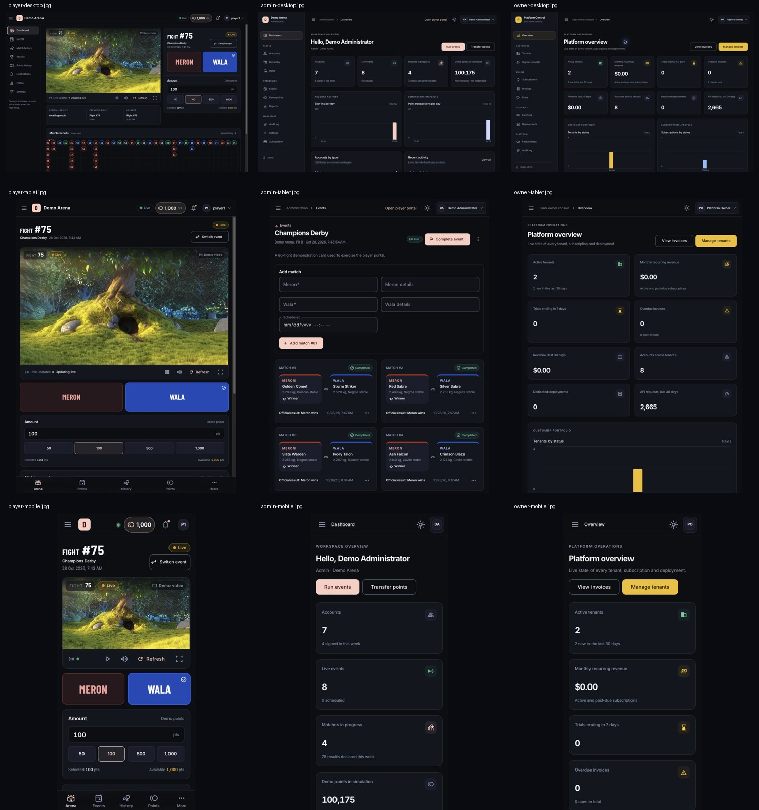

# Midnight Arena design system

Midnight Arena is the default presentation of the existing Player, Admin, and Owner Angular applications. The applications retain their routes, roles, services, and API contracts. This change does not merge the applications, add backend functionality, or change deployment topology.

## Shared implementation

| Layer | Source | Purpose |
|---|---|---|
| Foundations | `web/shared/styles/_midnight.scss` | Neutral surfaces, fixed outcome colors, readable semantic inks, typography, spacing, radii, shadows, control dimensions, motion, and Material component styles |
| Material entry | `web/shared/styles/material.scss` | Includes the shared foundations for every application |
| Tailwind | `web/shared/styles/tailwind.css` | Resolves color utilities through the same CSS and Material tokens |
| Breakpoints | `web/shared/styles/_breakpoints.scss` | Shared phone, tablet, and compact navigation breakpoint mixin |
| Runtime palette | `web/shared/services/theme.service.ts` | Saved display preferences, dark fallback, contrast-mapped tenant accents, safe dark surface variations |
| Runtime identity | `web/shared/services/branding.service.ts` | Tenant application name, logo, document title, favicon, and palette |
| Navigation | `web/shared/components/shell.ts` and `shell.scss` | Collapsible desktop navigation, mobile drawer, current-route context, account actions |
| Sign-in | `web/shared/components/auth-layout.scss` | Shared branded authentication presentation |
| Data and feedback | `web/shared/components/` | Headers, KPI cards, tables, charts, status chips, loading, empty/error states, and confirmation dialogs |

Use `var(--surface)`, `var(--text-primary)`, and other shared tokens in component styles. Use `bg-surface`, `text-on-surface-variant`, `border-outline-variant`, and other mapped utilities in templates. Use `--mat-sys-primary` for tenant-controlled actions; use fixed `--meron`, `--wala`, `--draw`, and `--cancelled` for outcome identification. The lighter `*-text` tokens are intended for small semantic labels on dark surfaces.

Inter is the shared interface font. Barlow Condensed is reserved for Player fight numbers and display labels. Both retain system fallbacks. Production builds do not inline remote fonts; the existing runtime font links remain in each application's HTML entry.

## Tenant branding

- Existing branding endpoints and stored configurations are preserved. Saved tenant branding takes precedence over new-form defaults.
- New defaults use gold primary, blue secondary, and Midnight neutral surfaces.
- Accents are converted to Material tonal palettes with increased contrast. Primary foreground/background pairs are tested against WCAG AA for white, black, red, green, blue, and gold input colors in both display modes.
- Dark background/surface overrides must be six-digit hex colors with relative luminance at most `0.035`. Bright legacy surfaces fall back to Midnight in dark mode, while remaining available in the existing light variation.
- Palette changes never rewrite the fixed outcome colors. Removing a custom surface or favicon resets its prior override.
- The default display preference is dark. An explicitly saved light or system preference remains honored. The Player arena retains its existing dark presentation.
- Branding preview remains reversible through **Discard preview**. No branding settings were saved during this verification pass.

## Portal behavior

**Player:** responsive 16:9 authorized demonstration media, prominent fight number, plain equal MERON/WALA panels, non-redeemable demo amounts, official-result grid and statistics. The existing six-row streak utility, corrections, replay protection, history routes, and live connection remain intact. On phones the full tenant name remains available in navigation and the home link's accessible label; the header keeps the tenant logo/mark without a cramped text fragment.

**Admin:** operational KPI overview, actual account/activity charts, account distribution, and existing management pages inherit shared navigation, tables, forms, dialogs, and feedback. Existing search, sorting, paging, filtering, role guards, and operational actions are retained. Small screens disclose table filters and keep secondary columns inside the existing responsive table behavior.

**Owner:** platform KPI overview, actual tenant/subscription status charts, usage summaries, and existing tenant, subscription, invoice, license, deployment, feature, and audit screens use the same enterprise shell. Billing and license operations are unchanged.

Animations are short, and reduced-motion preferences disable decorative movement. Keyboard focus remains visible; side selection and outcome information also have textual and accessible labels.

## Verification and screenshots

See [the verification report](../../design-qa.md) for scope and limits, [test output](frontend-tests.log), [production build output](production-builds.log), and [contrast measurements](contrast.json).

| Portal | Desktop | Tablet | Mobile |
|---|---|---|---|
| Player | [Arena](player-desktop.jpg) | [Arena](player-tablet.jpg) | [Arena](player-mobile.jpg), [records](player-records-mobile.jpg), [result detail](player-result-mobile.jpg) |
| Admin | [Overview](admin-desktop.jpg), [accounts](admin-accounts-desktop.jpg), [dialog](admin-account-dialog.jpg) | [Event operations](admin-tablet.jpg) | [Overview](admin-mobile.jpg), [event operations](admin-event-mobile.jpg) |
| Owner | [Overview](owner-desktop.jpg), [tenants](owner-tenants-desktop.jpg), [dialog](owner-tenant-dialog.jpg) | [Overview](owner-tablet.jpg) | [Overview](owner-mobile.jpg), [tenant filters](owner-tenants-mobile.jpg) |
